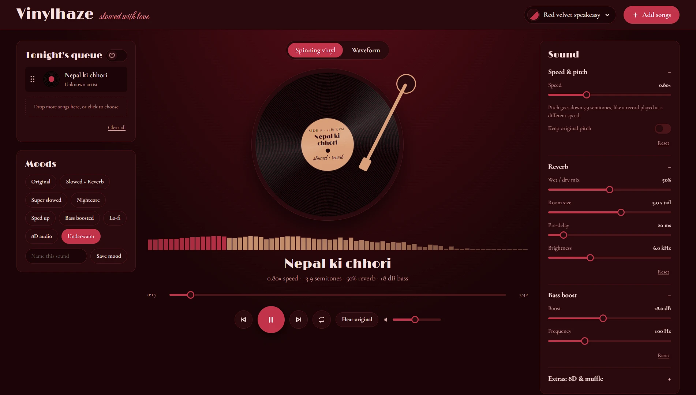
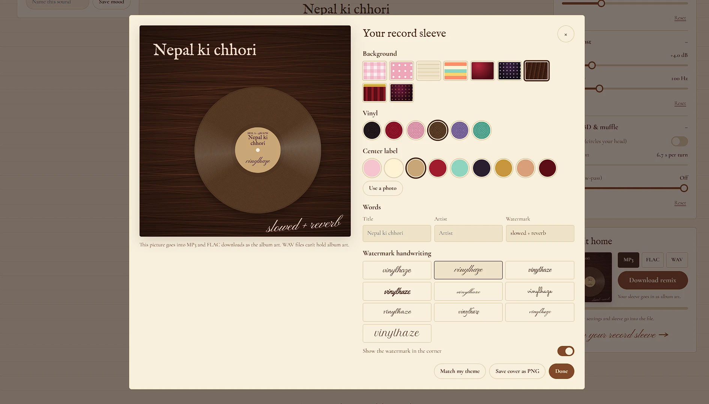
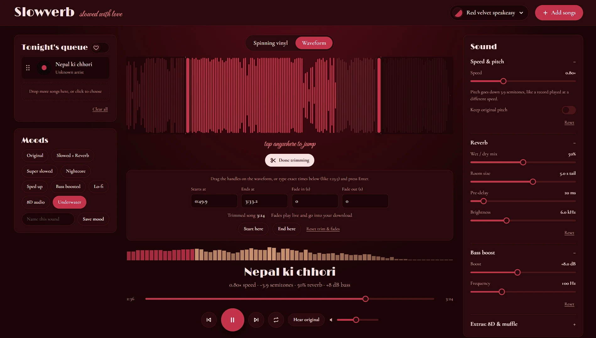
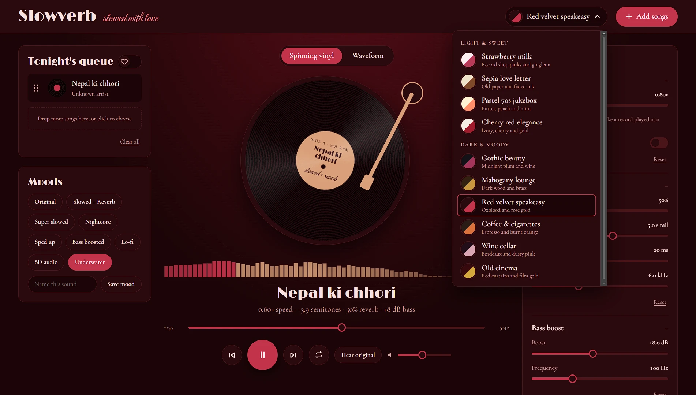

# Vinylhaze

**Slowed + reverb, right in your browser.** Drop in a song, slow it down, drench it in reverb, warm up the bass, and take home a file with its own little record sleeve.

⋆.ೃ࿔.𖥔 ݁ ˖\*:･༄ **Try it live → [vinylhaze.pages.dev](https://vinylhaze.pages.dev)** \*

## Why I made this

I couldn't find some of my favorite songs on YouTube in a slowed + reverb version. Whenever I tried websites that could slow songs down and add reverb, the result never felt or hit the way I needed it to. Either the pitch was off, or some of the most basic features were locked behind a paid plan, which didn't make sense to me.

So I decided to make my own website, where I can happily change the vibe of a song exactly the way I want. I feel like there are people out there who have felt the same way I did. So here we are with **Vinylhaze**.

## Features

- **Speed & pitch:** 0.5×–1.5×, with an optional "keep original pitch" mode (time-stretching)
- **Reverb:** wet/dry mix, room size, pre-delay and brightness
- **Bass boost:** adjustable amount and frequency
- **Extras:** 8D audio (sound circling your head) and a low-pass "muffle" filter
- **Moods:** presets like Slowed + Reverb, Nightcore, Lo-fi and Underwater, plus your own saved moods
- **Two player views:** a spinning turntable (it turns at 33⅓ rpm, slower when the song is slowed) or a clickable waveform
- **Trim:** drag handles on the waveform or type exact times, with adjustable fade in/out you can hear live
- **Queue:** drag to reorder, loop, and crossfade between songs
- **Record sleeve maker:** design cover art (patterns, vinyl colour, a photo on the label, a handwritten watermark) that gets embedded in your download
- **Downloads:** MP3, FLAC or WAV, with title, artist and cover art tags (MP3 and FLAC)
- **10 themes:** five light ("Strawberry milk", "Sepia love letter", …) and five dark ("Mahogany lounge", "Old cinema", …)

| Record sleeve maker | Trim on the waveform | 10 themes |
|---|---|---|
|  |  |  |

## How it works

Everything runs in the browser with the **Web Audio API**. There is no server and no upload step.

- **Live playback** sends the decoded song through a chain of audio nodes: a low-shelf filter for bass, a low-pass filter, a convolution reverb (the impulse response is generated in code), a stereo panner driven by an oscillator for 8D, and a compressor acting as a limiter.
- **Downloads** run the same chain through an `OfflineAudioContext`, which renders faster than real time.
- **Keep original pitch** uses a WSOLA time-stretch, written from scratch, so the tempo changes without the pitch moving.
- **FLAC and WAV encoders** are written from scratch, including FLAC's metadata blocks for tags and cover art. MP3 encoding uses [lamejs](https://github.com/zhuker/lamejs), and MP3 tags are written as ID3v2.3.
- **Cover art** is drawn on a `<canvas>` and embedded as JPEG.

## Privacy & security

- Songs never leave your device. They are decoded and processed locally.
- Only your preferences (theme, settings, saved moods) are stored, in your own browser's `localStorage`.
- The live site sends a strict Content Security Policy and other security headers.
- The one third-party script (lamejs, loaded the first time you download an MP3) is pinned with Subresource Integrity.

## A note on music

Vinylhaze is for personal listening. Songs belong to their artists. Please don't upload remixes of music you don't have the rights to.

## Credits

- [lamejs](https://github.com/zhuker/lamejs) for MP3 encoding (LGPL-3.0)
- Fonts from [Google Fonts](https://fonts.google.com) (SIL Open Font License)

## Source code

The source code is kept private. If you're reviewing my work and would like to see it, feel free to reach out.

## License

© 2026 Sneha. All rights reserved. The code, design and artwork in this project may not be copied, reused or redistributed without permission.

---

For my music lovers. With love, Sneha ♡
